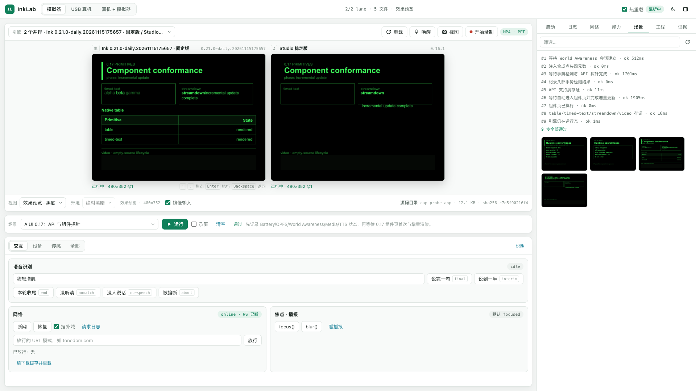

# InkLab

[简体中文](README.zh-CN.md)

**A local debugging and testing workbench for AIUI apps** — the app format of Rokid AR glasses. Open an app's source folder (or a packaged `.aix`) in your browser, run it on one or more versions of the real Ink rendering engine side by side, and drive it with simulated hardware — speech, camera, motion sensors, battery, Bluetooth, network, LLM — so you can test with scripts and screenshot baselines on your computer before testing on physical glasses.



> **Unofficial project.** InkLab is not affiliated with, endorsed by or supported by Rokid. "Rokid" and "AIUI" belong to their respective owners. InkLab does not contain or redistribute Rokid's engine; see [The runtime engine](#the-runtime-engine).

## What it does

- **Hot reload** — edit the source and the page reloads automatically via a file watcher.
- **Runtime lanes side by side** — run the same app on several pinned engine builds at once to compare renders; keyboard and scripted input are mirrored to every lane.
- **Realistic hardware simulation** — inject speech (ASR/TTS), camera photos, IMU sensor traces, battery levels, BLE devices, network failures and LLM responses (live, recorded or replayed). The simulators intentionally reproduce real-device edge cases (ASR aborting mid-turn, camera shutter delay, sticky sensor permission faults) rather than an idealised contract.

  Speech simulation supports both legacy recognition and the streaming transport used by 0.18+ engines. Audio-only capture uses an inert local track and mock PCM frames, without requesting microphone access; transcripts still come from injected text. This verifies application behavior, not acoustic recognition quality.
- **Automated scenarios and screenshot baselines** — declarative JS scripts (key presses, waits, screenshots, assertions) run interactively in the browser or headless in CI. Baselines carry a fingerprint of the source and engine, so outdated baselines are flagged as `stale` instead of silently passing.
- **Test reports and stage recording** — export `run.json` (source identity, engine hashes, timeline, network log, artifacts) and record the stage canvas as MP4/WebM.
- **Optional: real glasses over USB** — push a debug build to the glasses and open it with one click (or on every save), replay real touchpad gestures, stream a live mirror and the app's logs, align the simulator engine with the glasses' Ink version, run simulator scenarios on the glasses with a side-by-side screenshot comparison, and mock the IMU in debug builds (replay a recorded trace, drive it live from the workbench, or record real readings as project traces the simulator plays too). See [docs/device.md](docs/device.md) (Chinese).

InkLab runs the same rendering engine that Rokid publishes on npm and embeds in the AIUI Studio and Craft web previews, so **it replaces manual clicking in Craft, not final testing on physical glasses**: optics, power draw, real sensor accuracy, microphone acoustics and Bluetooth radio still require real hardware verification.

## Quick start

You need Node.js 22 or later and Chrome. There are no npm runtime dependencies to install.

```bash
git clone --branch v0.2.0 --depth 1 https://github.com/1977744311/inklab.git
cd inklab
npm run install-cli                         # symlink inklab, inklab-e2e and friends into ~/.local/bin
inklab-engine                               # first run: downloads the latest engines from npm, AIUI Studio and Craft
inklab fixtures/cap-probe-app --open
```

`install-cli` symlinks the commands into `~/.local/bin` (`--bin-dir` picks another directory), independent of the Node version fnm or nvm currently selects. The links point at this clone, so `git pull` updates the commands, and the engine cache stays in this clone's `.engine/`. After that, run `inklab <app-dir>` or `inklab-e2e <app-dir>` from any project. `npm run install-cli -- --uninstall` removes them. Inside this repository the `npm start --` / `npm run e2e --` forms keep working.

The workbench opens at <http://127.0.0.1:8788/>. `fixtures/cap-probe-app` is a built-in probe app so you can try every feature right away; when you have your own app, pass its source directory or `.aix` file instead. To compare two engine versions side by side, tick two lanes in the workbench or open `?runtimes=<id>,<id>` (lane ids are listed by `inklab-engine --list`; channel names such as `latest` and `daily` work too).

This quick start uses v0.2.0. For InkLab development, use `main`. [Release notes](https://github.com/1977744311/inklab/releases/tag/v0.2.0) · [Contributing](CONTRIBUTING.md)

> The workbench UI is in Chinese for now.

## Public networks and multiple players

```bash
npm start -- <app> --allow-external tonedom.com --players 2 --open
npm run e2e -- <app> --players 4 --allow-external tonedom.com --scenario <id>
```

External traffic is still blocked by default. Repeat `--allow-external <pattern>` or add
`{"allowExternal":["tonedom.com"]}` to the app's optional `inklab.config.json`; CLI and config lists are merged, including in e2e.
The Network controls also show the list, add patterns and toggle the guard. Patterns retain URL substring / `*` glob semantics.
Fetch and WebSocket share this policy; going offline closes sockets and aborts downloads. The app owns reconnection. Logs include decisions, WS open/close events and message counts.

`--players 1–6` or `?players=N` opens independent players, instead of a runtime comparison.
Click a tile, press Alt+1…6, or press Tab while a player view has focus to select a player. Keys, head gestures and the expanded controls target that player.
Each player has its own engine, capabilities and device identity, with browser localStorage/OPFS scoped by app and player.
Pop out transfers a seat to another window; closing it restores the tile. Multiplayer uses 1× canvases at about 20fps.
Tiles show WS status and download progress. Clear one/all players' OPFS and reload to retest downloads; this also removes other files the app stores in OPFS, while preserving localStorage device identity.
Scenario `build({ players })` receives `players[i].press(key)`, `.shot(name)` and `.caps`; see the [guide](docs/guide.md#多玩家场景).

The header switches between **模拟器** (simulator), **USB 真机** (USB glasses), and **真机 + 模拟器** (side by side). Start with `--device` to control USB glasses. On desktop, the side-by-side view fits both previews at the same size beside the device controls. Join the same app room on both sides and use the simulator's offline and online controls to exercise reconnects. See [USB setup](docs/device.md).

## Core concepts

| Term | Meaning |
| --- | --- |
| **AIUI app** | A source directory with `app.json`, `app.js` and `pages/**/*.ink`. Its packaged form is a `.aix` (zip) archive. |
| **Runtime (lane)** | One pinned build of Rokid's `ink_web` engine: a JS glue file plus a WebAssembly binary. Each build is recorded as a lane (e.g. `npm-ink-0.20.0`) and locked by SHA-256 in your local `runtimes.lock.json`. |
| **Channel** | A moving name for the newest matching lane: `latest` (newest release, the default), `daily` (newest build, daily builds included) or `studio` (the build AIUI Studio's web preview embeds). Write a channel in project scripts; write a lane id only to reproduce an old result. |
| **Host capabilities** | Device APIs requested by an app: speech, camera, sensors, battery, Bluetooth, network, LLM. InkLab provides controllable simulators in the browser. |
| **Scenario** | A small JS module defining steps and assertions. The built-in `smoke` scenario works for any app; app-specific scenarios live in `<app>/e2e/scenarios/`. |
| **Baseline** | Reference screenshots stored in `<app>/e2e/baselines/`, stamped with a fingerprint of the source and engine for pixel-level regression checks. |
| **Cassette** | Recorded LLM responses stored in `<app>/e2e/cassettes/`, replayed deterministically offline without an API key. |

Your app's tests live in your app's repository; InkLab only provides the host runner.

## Commands

| Command | What it does |
| --- | --- |
| `inklab <app-dir\|pkg.aix> [--port 8788] [--open] [--compare-with <dir\|pkg.aix>]` | Start the workbench. `--compare-with` shows a file-level diff against a second source or `.aix`. |
| `inklab-e2e <app-dir\|pkg.aix> [--scenario id] [--runtime latest\|daily\|<lane>] [--accept] [--headed]` | Run scenarios in headless Chrome, compare screenshot baselines, and write the report to `<app>/e2e/report/last-run.json`. `--accept` saves this run's screenshots as new baselines. |
| `inklab-matrix <app-dir\|pkg.aix> [--scenario id] [--runtime a,b] [--all-lighting]` | Run one scenario across multiple runtime lanes (and ambient lighting backgrounds) and summarise differences. |
| `inklab-engine [<lane>…] [--check\|--discover\|--list]` | Check npm (`@yodaos-pkg/ink`, tags `latest` and `daily`), AIUI Studio and Craft for engine builds, append new lanes to `runtimes.lock.json`, and download missing files into `.engine/`. `--check` verifies local files offline; `--discover` previews new builds without writing (exits with 2 if found); `--list` shows the lanes and where each channel points (`--list --json` for scripts). |
| `inklab-device info\|push <app>\|open\|exit\|gesture <name>\|agents` | Real glasses over USB (optional): show the device and its Ink version, push and open a debug build, replay touchpad gestures, list debug agents. |
| `inklab-device <app-dir> --serial SN --scenario ID` | Run a device scenario or a simulator `.mjs` scenario on real glasses; simulator scenarios also get a side-by-side `compare.html`. |
| `inklab-device push <app> --imu replay\|record --trace NAME` · `imu-record` · `imu-guide` | Mock IMU on real glasses: push a debug build that replays a trace or records real readings; record a guided session into `e2e/traces/`. |
| `inklab-device wifi [--off]` | Wireless debugging: run once with the cable in, then unplug; commands pick the Wi-Fi connection. |
| `npm run install-cli [-- --uninstall]` | Install or remove the commands above (see Quick start). Every command accepts `--help` and `--version`. |
| `npm test` · `npm run lint` | Unit test suite (needs no external network or browser) · ESLint (`npm ci` first; devDependencies are for linting only). |

LLM access is optional: set `INKLAB_LLM_ENDPOINT`, `INKLAB_LLM_API_KEY` and `INKLAB_LLM_MODEL`, or create an untracked `llm.local.json`. Without it, apps receive "model unavailable" and take their offline path. Details are in the [guide](docs/guide.md#llm-怎么接).

## The runtime engine

`ink_web` is Rokid's rendering engine. Rokid publishes it on npm as `@yodaos-pkg/ink` (`latest` is the newest release, `daily` the newest daily build) and embeds older builds in the AIUI Studio and Craft web previews. It is **not** included in this repository or its npm package, and InkLab grants no rights to it. `inklab-engine` downloads the package tarball from the npm registry (checked against its `integrity`) and the glue JS and WebAssembly binary from Rokid's servers (`aiui.rokid.com`, `static.rokidcdn.com`, `js.rokid.com`), verifies their SHA-256 hashes against `runtimes.lock.json`, and caches them in `.engine/`.

You rarely need to run it by hand. `inklab`, `inklab-e2e` and `inklab-matrix` check npm at most once a day when they start and download a new `latest` or `daily` version automatically, so the `latest` and `daily` channels follow new releases. If the check fails (offline, slow registry), they print one warning and use the cached engines. Set `INKLAB_NO_UPDATE=1` to skip the check, `INKLAB_UPDATE=force` to check now, and `INKLAB_NPM_REGISTRY` to use a mirror.

Both paths are local, git-ignored state and excluded from the npm package:

- `runtimes.lock.json` is an append-only JSON array of lanes created on the first engine download. Each lane pins its source, version and SHA-256 hashes (recorded on first download; every later download must match). The default lane is the `latest` channel among the cached lanes, whatever the order. A project can choose its own default with `"runtime": "daily"` (a channel or lane id) in the app's `inklab.config.json`, which never goes into the package; `INKLAB_RUNTIME=<lane or channel>` overrides both for one run, and `--runtime` / `?runtimes=` override everything.
- `.engine/` holds the downloaded binaries, one directory per lane (`INKLAB_ENGINE_DIR` overrides the path). Downloads show speed and ETA, abort after 30 s without data, and retry up to three times.

See [the guide](docs/guide.md#引擎版本会漂) for discovery rules and how to register a lane by hand. You are responsible for using the engine in line with Rokid's terms.

## Requirements

- Node.js 22 or later. CI runs the test suite on macOS and Ubuntu with Node 22 and 24.
- Chrome for the workbench (other browsers are untested).
- Headless runs (`npm run e2e`, `npm run matrix`) need Chrome or Chromium, auto-detected on macOS and Linux (Edge as well on macOS). Otherwise set `INKLAB_CHROME` or pass `--chrome`.
- Real glasses additionally need `adb` and `ffmpeg`; automatic text assertions use macOS Vision OCR.
- Windows is untested.

## Troubleshooting

| Symptom | Fix |
| --- | --- |
| `runtimes.lock.json 里还没有运行时…` or `还没取任何运行时…` ("no runtimes yet") | The list or `.engine/` is empty. Run `inklab-engine` while online to discover and download the engines. |
| `没能检查 npm 上的新引擎…` ("could not check npm for new engines") at startup | Informational. The daily check failed, so the cached engines are used; it retries on the next start. |
| `运行时不可用：…` ("runtime not available", e2e) | The lane id is not cached. Use a channel name (`latest`, `daily`, `studio`) or an id from `inklab-engine --list`. |
| The download is slow or looks stuck | Stalled files (30 s without data) retry automatically. You can also copy `runtimes.lock.json` and `.engine/` from another machine and verify with `npm run engine -- --check`. |
| The page shows `forbidden: host` | Open the workbench through `http://127.0.0.1:<port>/` or `http://localhost:<port>/`. Other host names (a LAN address, a reverse proxy) are refused on purpose. |
| `EADDRINUSE` | The port is taken. Pick another with `--port`. |
| `找不到 Chrome` ("Chrome not found", e2e) | Install Chrome or Chromium, or set `INKLAB_CHROME=/path/to/chrome`. |
| `默认运行时 … 本机没有缓存` ("default runtime not cached") at startup | Informational. The newest release lane in `runtimes.lock.json` is not in `.engine/`, so the newest cached release is used. Run `inklab-engine` to download it. |

## Documentation

The long-form documents are in Chinese for now; issues and pull requests in English or Chinese are both welcome.

- [Guide](docs/guide.md) — workbench, host capabilities, scenarios, e2e, LLM modes, screenshot baselines.
- [Real glasses over USB](docs/device.md) — push and open debug builds, touchpad gestures, live mirror and logs, mock IMU and trace recording, device scenarios, app-provided control scripts.
- [Runtime field notes](docs/runtime-notes.md) — measured engine behaviour and timing rules; read before scripting an app.

## Security

InkLab is a local development tool. It listens on `127.0.0.1` only and rejects requests whose `Host` is not loopback. Do not expose its port to a network. The LLM key you configure is handed to the page, because the in-browser engine makes the request itself. See [SECURITY.md](SECURITY.md).

## Contributing and license

See [CONTRIBUTING.md](CONTRIBUTING.md). InkLab's own source code is released under the [MIT License](LICENSE). The license covers InkLab's code only, not Rokid's engine; see [NOTICE](NOTICE) and [The runtime engine](#the-runtime-engine).
