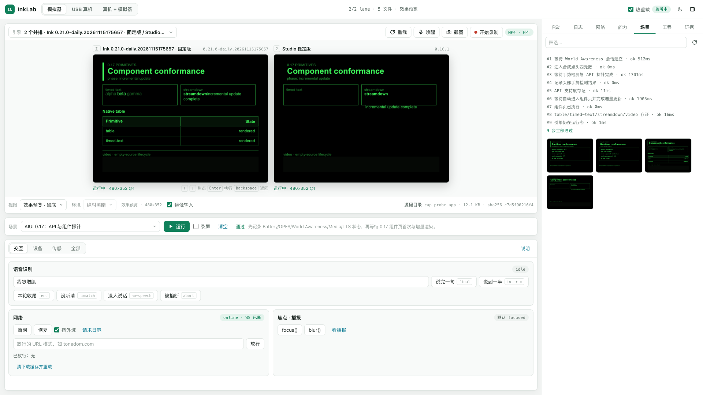

# InkLab

[English](README.md)

**AIUI 应用的本地调试与测试工作台**——AIUI 是 Rokid AR 眼镜的应用格式。在浏览器里直接打开应用源码目录（或打包好的 `.aix`），用真实的 Ink 渲染引擎跑起来，支持同时并排运行多个引擎版本；语音、相机、运动传感器、电池、蓝牙、网络、大模型（LLM）等硬件能力均由可控的模拟器提供，让你不用戴上眼镜，就能在电脑上用脚本和截图基线完成自动化测试。



> **非官方项目。** InkLab 与 Rokid 没有隶属关系，也未获得其认可或支持。“Rokid”“AIUI”归各自权利人所有。InkLab 不包含也不分发 Rokid 的引擎，详见[运行时引擎](#运行时引擎)。

## 它能做什么

- **热重载**——修改源码后页面自动刷新（服务端监听文件变更并实时推送）。
- **多引擎版本并排对比**——同一个应用同时跑在多个版本的引擎上，直观对比画面差异；键盘操作和测试脚本会同步发给每个版本。
- **贴近真机的硬件模拟**——手动或用脚本注入语音（ASR/TTS）、相机照片、传感器轨迹（IMU）、电量、蓝牙（BLE）设备、网络故障和大模型回复（在线请求、录制、离线回放）。模拟器刻意复现了真机上的常见异常（如语音识别中途意外中断、拍照存在延迟、传感器权限报错后不会自动恢复），而不是只模拟理想情况。

  语音模拟同时支持旧识别接口与 0.18+ 引擎的流式接口。纯音频采集使用本地空音轨和模拟 PCM 帧，无需申请麦克风权限；识别结果仍由文字注入，用于验证应用行为，不能证明真实声音的识别质量。
- **自动化场景与截图比对**——用简单的 JS 脚本编排按键、等待、截图和断言，可在浏览器里交互运行，也可在无头浏览器（Headless Chrome）中跑 CI。参考截图带有源码和引擎版本的指纹，一旦代码或引擎更新而截图未更新，会自动标记为过期（`stale`）。
- **测试报告与录屏**——一键导出 `run.json`（包含源码版本、引擎哈希、执行时间线、网络日志、截图产物），或将应用画面直接录制成 MP4/WebM 视频。
- **可选：USB 连真机联动**——一键（或每次保存）把调试包推到眼镜上并打开，回放真实触控板手势，实时投屏并显示应用日志，模拟器引擎自动对齐眼镜上的 Ink 版本，模拟器场景直接在真机上跑并生成截图对照；调试包里还能模拟 IMU（回放录好的轨迹、从工作台实时下发，或把真机读数录成工程轨迹，模拟器也放同一批文件），见 [docs/device.md](docs/device.md)。

InkLab 用的是 Rokid 在 npm 上发布、并嵌在 AIUI Studio 与 Craft 网页里的同一个渲染引擎，因此**它能替代在 Craft 里手动点测，但不能替代最终的真机验收**：光学显示、功耗、真实传感器精度、麦克风收音和蓝牙信号仍需在真实眼镜上验证。

## 快速开始

需要 Node.js 22 或更高版本，以及 Chrome 浏览器。无需 `npm install` 安装任何运行时依赖。

```bash
git clone --branch v0.2.0 --depth 1 https://github.com/1977744311/inklab.git
cd inklab
npm run install-cli                         # 把 inklab、inklab-e2e 等命令软链到 ~/.local/bin
inklab-engine                               # 首次运行：从 npm、AIUI Studio 和 Craft 获取最新引擎并缓存到本地
inklab fixtures/cap-probe-app --open
```

`install-cli` 把命令软链到 `~/.local/bin`（`--bin-dir` 可换目录），跟 fnm / nvm 当前选的 Node 版本无关；链接指向这份 clone，`git pull` 之后命令就是新版，引擎缓存也仍在这份 clone 的 `.engine/` 里。之后在任何项目目录里都可以直接用 `inklab <应用目录>`、`inklab-e2e <应用目录>`。`npm run install-cli -- --uninstall` 卸载。不想装命令时，在本仓库里照旧用 `npm start --`、`npm run e2e --` 等写法。

浏览器会自动打开 <http://127.0.0.1:8788/>。`fixtures/cap-probe-app` 是仓库自带的示例探针应用，方便你直接体验所有功能；调试自己的应用时，把路径换成你的源码目录或 `.aix` 文件即可。想并排对比两个引擎版本，只需在预览左上角的「引擎」下拉面板里勾选两个版本，或在 URL 后加上 `?runtimes=<id>,<id>`（版本 id 用 `inklab-engine --list` 查看；也可以写通道名 `latest`、`daily`）。

以上命令使用 v0.2.0。参与 InkLab 开发时请使用 `main`。[发布说明](https://github.com/1977744311/inklab/releases/tag/v0.2.0) · [贡献指南](CONTRIBUTING.md)

## 公网下载与多玩家

```bash
npm start -- <应用> --allow-external tonedom.com --players 2 --open
npm run e2e -- <应用> --players 4 --allow-external tonedom.com --scenario <场景>
```

外域默认仍拦截。`--allow-external <pattern>` 可重复，和应用目录中可选的
`inklab.config.json`（如 `{"allowExternal":["tonedom.com"]}`）合并；工作台「网络」可增添放行项、查看清单或切换外域闸。
规则沿用 URL 子串 / `*` 通配符语义，同时控制 fetch 和 WebSocket；整体断网会关闭 WS、中止下载，恢复后由应用自行重连。网络日志包含判定、WS 开关与消息计数。

`--players 1–6` 或 `?players=N` 启动独立玩家网格（与多引擎 lane 二选一）。点击画面、按 Alt+1…6 或在玩家画面聚焦时按 Tab 切换玩家。按键、点头、摇头及展开的控制台只作用于当前玩家。
每人拥有独立引擎、能力与设备身份；浏览器 localStorage/OPFS 按应用和玩家隔离。「单独窗口」会转移该席位，关闭窗口后返回网格。
多玩家使用 1 倍画布、约 20fps。每格显示 WS 状态和下载进度；可清当前或全部玩家的 OPFS 并重载（也会清掉应用写在 OPFS 内的其他文件，保留 localStorage 设备身份）。
自动化场景的 `build({ players })` 可调用 `players[0].press('Enter')`、`players[1].shot('lobby')`、`players[i].caps.net.offline()`；详见[指南](docs/guide.md#多玩家场景)。

顶部模式栏可在「模拟器」「USB 真机」「真机 + 模拟器」之间切换。切到「USB 真机」就启用真机（普通启动不碰 ADB），只连着一副眼镜时自动选上；`--device` 让它一启动就启用。桌面端并排显示同尺寸预览和真机设置。各页共用顶栏的浅色/暗色切换。联调时让两端进同一个应用房间，用模拟器的断网、恢复联网按钮复测重连。连接方法见 [USB 真机](docs/device.md)。

## 核心概念

| 名词 | 含义 |
| --- | --- |
| **AIUI 应用** | 包含 `app.json`、`app.js` 和 `pages/**/*.ink` 的源码目录；打包后为 `.aix`（zip 格式）文件。 |
| **运行时（lane）** | Rokid `ink_web` 引擎的一个特定版本构建（由一个 JS 胶水文件和一个 WebAssembly 文件组成）。每个版本在 `runtimes.lock.json` 中有一条记录（称为一条 lane，如 `npm-ink-0.20.0`），并锁定文件的 SHA-256 哈希。 |
| **通道（channel）** | 指向「最新的那条 lane」的活名字：`latest`（最新正式版，也是默认）、`daily`（最新构建，含每日构建）、`studio`（AIUI Studio 网页版内嵌的那个）。项目脚本里写通道名；只有要复现某次旧结果时才写具体 lane id。 |
| **宿主能力** | 应用向眼镜系统调用的硬件与系统接口：语音、相机、传感器、电池、蓝牙、网络、LLM。InkLab 在浏览器中提供这些接口的模拟实现。 |
| **场景（Scenario）** | 定义操作步骤与检查条件的小型 JS 模块。InkLab 内置了通用的 `smoke`（冒烟测试）场景；应用专属的场景放在应用自己的 `<app>/e2e/scenarios/` 目录下。 |
| **截图基线（Baseline）** | 保存在 `<app>/e2e/baselines/` 下的参考截图，附带源码与引擎指纹，用于像素级视觉回归比对。 |
| **录制文件（Cassette）** | 保存在 `<app>/e2e/cassettes/` 下的大模型历史响应记录，回放时无需联网、无需 API Key，且每次返回结果固定。 |

应用自己的测试文件保存在应用自己的仓库中；InkLab 只作为运行和测试工具。

## 常用命令

| 命令 | 作用 |
| --- | --- |
| `inklab <应用目录\|包.aix> [--port 8788] [--open] [--compare-with <目录\|包.aix>]` | 启动本地工作台。`--compare-with` 可对比另一份源码或 `.aix` 包的文件差异。 |
| `inklab-e2e <应用目录\|包.aix> [--scenario id] [--runtime latest\|daily\|<lane>] [--accept] [--headed]` | 在无头 Chrome 中运行场景并比对截图基线，结果写入 `<app>/e2e/report/last-run.json`。加上 `--accept` 会将本次截图保存为新基线。 |
| `inklab-matrix <应用目录\|包.aix> [--scenario id] [--runtime a,b] [--all-lighting]` | 将同一场景跨多个引擎版本（及不同环境光背景）运行一遍，生成差异对比报告。 |
| `inklab-engine [<lane>…] [--check\|--discover\|--list]` | 检查 npm（`@yodaos-pkg/ink` 的 `latest`、`daily` 标签）、AIUI Studio 和 Craft 上的引擎版本，把新版本记入 `runtimes.lock.json`，并下载 `.engine/` 中缺失的文件。`--check` 仅在本地校验文件完整性；`--discover` 仅预览线上是否有新版本（有新版本时退出码为 2）；`--list` 列出本机的 lane 和各通道当前指向哪条（`--list --json` 给脚本用）。 |
| `inklab-device info\|push <应用>\|open\|exit\|gesture <手势>\|agents` | USB 真机（可选）：查看设备与 Ink 版本、推送并打开调试包、回放触控板手势、列出调试包。 |
| `inklab-device <应用目录> --serial SN --scenario ID` | 在真实眼镜上运行真机场景或模拟器 `.mjs` 场景；模拟器场景另出一份截图对照 `compare.html`。 |
| `inklab-device push <应用> --imu replay\|record --trace 名字` · `imu-record` · `imu-guide` | 真机模拟 IMU：推回放轨迹或录制真机读数的调试包；引导录制一整套动作存进 `e2e/traces/`。 |
| `inklab-device wifi [--off]` | 无线调试：插着线跑一次，之后拔线；命令会自动用 Wi-Fi 那个连接。 |
| `npm run install-cli [-- --uninstall]` | 安装或卸载上面这些命令（见快速开始）。每个命令都支持 `--help` 和 `--version`。 |
| `npm test` · `npm run lint` | 运行单元测试（无需联网和浏览器）· 运行 ESLint 代码检查（需先执行 `npm ci`）。 |

大模型（LLM）配置是可选的：可通过环境变量 `INKLAB_LLM_ENDPOINT`、`INKLAB_LLM_API_KEY`、`INKLAB_LLM_MODEL` 配置，或在项目根目录创建本地文件 `llm.local.json`。未配置时，应用会收到“模型不可用”提示并走离线逻辑。详见[使用指南](docs/guide.md#llm-怎么接)。

## 运行时引擎

`ink_web` 是 Rokid 的渲染引擎。Rokid 把它发布在 npm 上（`@yodaos-pkg/ink`：`latest` 是最新正式版，`daily` 是最新每日构建），AIUI Studio 和 Craft 网页里嵌的是更旧的构建。它**不包含**在本仓库及 npm 包中，InkLab 也不授予任何引擎使用权。执行 `inklab-engine` 时，脚本会从 npm registry 下载引擎包（按 `integrity` 校验），并从 Rokid 官方服务器（`aiui.rokid.com`、`static.rokidcdn.com`、`js.rokid.com`）下载浏览器打开这些网页时加载的同名 JS 和 WASM 文件，校验 SHA-256 哈希后缓存在本地。

一般不用手动运行它：`inklab`、`inklab-e2e`、`inklab-matrix` 启动时会查一次 npm（一天最多一次），有新的 `latest` 或 `daily` 版本就自动下载，`latest`、`daily` 通道随之指向新版本。查不了（断网、registry 慢）只打一行警告，照常用本机已有的引擎。`INKLAB_NO_UPDATE=1` 关掉检查，`INKLAB_UPDATE=force` 立即检查，`INKLAB_NPM_REGISTRY` 可改用镜像。

引擎清单与二进制文件均属于本机状态，已被 `.gitignore` 忽略且不会打入 npm 包：

- `runtimes.lock.json`：首次下载引擎时自动生成的版本清单，记录每个引擎版本的来源、版本号和 SHA-256 哈希（首次下载时记录哈希，后续下载必须完全一致）。默认版本是本机已缓存版本里的 `latest` 通道，与列表顺序无关。项目可以在应用目录的 `inklab.config.json`（不进发布包）里写 `"runtime": "daily"`（通道名或 lane id）换成自己的默认；`INKLAB_RUNTIME=<lane 或通道名>` 可临时覆盖两者，`--runtime` / `?runtimes=` 优先级最高。
- `.engine/`：存放下载好的引擎文件，每个版本一个子目录（可通过环境变量 `INKLAB_ENGINE_DIR` 修改存放位置）。下载过程会显示速度与剩余时间，单文件超过 30 秒无响应会自动重试（最多 3 次）。

版本发现机制与手动添加引擎版本的方法见[使用指南](docs/guide.md#引擎版本会漂)。请确保在符合 Rokid 服务条款的前提下使用引擎。

## 环境要求

- Node.js 22 或更高版本（CI 在 macOS 和 Ubuntu 上使用 Node 22 和 24 测试）。
- Chrome 浏览器（用于打开工作台；其他浏览器未做兼容测试）。
- 运行自动化测试（`npm run e2e`、`npm run matrix`）需要本机安装 Chrome 或 Chromium（macOS 和 Linux 下自动查找，macOS 也支持 Edge；找不到时可通过 `INKLAB_CHROME` 或 `--chrome` 指定路径）。
- 连接真机测试还需安装 `adb` 和 `ffmpeg`；截图文字自动识别（OCR）依赖 macOS 的系统 Vision 接口。
- Windows 系统暂未测试。

## 常见问题

| 现象 | 解决办法 |
| --- | --- |
| `runtimes.lock.json 里还没有运行时…` 或 `还没取任何运行时…` | 本地还没有下载引擎。联网运行 `inklab-engine` 即可自动获取并下载。 |
| 启动时提示 `没能检查 npm 上的新引擎…` | 普通提示：每日检查没成功，本次用本机已有的引擎，下次启动再试。 |
| e2e 报 `运行时不可用：…` | 这个 lane 本机没有。改写通道名（`latest`、`daily`、`studio`），或用 `inklab-engine --list` 里列出的 id。 |
| 引擎下载很慢或卡住 | 超过 30 秒无数据会自动重试。你也可以直接从其他电脑拷贝 `runtimes.lock.json` 和 `.engine/` 目录，再运行 `npm run engine -- --check` 校验。 |
| 页面显示 `forbidden: host` | 请使用 `http://127.0.0.1:<端口>/` 或 `http://localhost:<端口>/` 访问。出于安全考虑，服务会拒绝局域网 IP 或反向代理域名访问。 |
| `EADDRINUSE` | 默认端口被占用，加上 `--port <新端口>` 启动即可。 |
| `找不到 Chrome`（e2e） | 安装 Chrome/Chromium，或设置环境变量 `INKLAB_CHROME=/path/to/chrome`。 |
| 启动时提示 `默认运行时 … 本机没有缓存` | 普通提示：清单里最新的正式版还没下载到本地，本次用已下载的最新正式版。运行 `inklab-engine` 下载即可。 |

## 文档导航

- [使用指南](docs/guide.md)——工作台功能、硬件模拟控制、编写测试场景、e2e 运行、LLM 录制回放、截图基线。
- [USB 连真机](docs/device.md)——推送并打开调试包、触控板手势、实时投屏与日志、模拟 IMU 与轨迹录制、真机测试场景、应用端控制脚本约定。
- [运行时实测笔记](docs/runtime-notes.md)——实测总结的引擎底层机制与时序规律，写自动化脚本前必读。

工作台界面与详细文档目前为中文；欢迎使用中文或英文提交 Issue 和 PR。

## 安全说明

InkLab 是纯本地开发工具，仅监听 `127.0.0.1` 回环地址，并拒绝非本机 `Host` 的请求。请勿将端口暴露到公网或局域网。由于浏览器内的引擎需要直接发起大模型请求，你配置的 LLM API Key 会下发给本地工作台页面。详见 [SECURITY.md](SECURITY.md)。

## 参与贡献与许可证

详见 [CONTRIBUTING.md](CONTRIBUTING.md)。InkLab 自身的源码采用 [MIT 许可证](LICENSE)开源；该许可证仅覆盖 InkLab 自身代码，不包含 Rokid 的引擎（见 [NOTICE](NOTICE) 和[运行时引擎](#运行时引擎)）。
