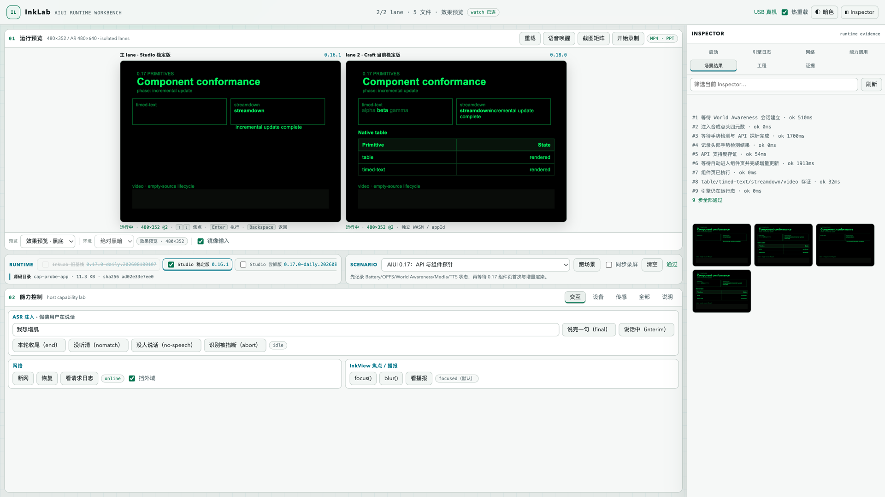

# InkLab

[English](README.md)

**AIUI 应用的本地工作台**——AIUI 是 Rokid AR 眼镜的应用格式。在浏览器里打开应用源码目录（或打包好的 `.aix`），用真实的 Ink 渲染引擎跑起来，可以同时并排跑多个引擎版本；语音、相机、运动传感器、电池、蓝牙、网络、LLM 这些硬件能力都由可控的模拟件提供，于是原本要戴着眼镜才能测的东西，可以用脚本和截图基线来测。



> **非官方项目。** InkLab 与 Rokid 没有隶属关系，也未获得其认可或支持。“Rokid”“AIUI”归各自权利人所有。InkLab 不包含也不分发 Rokid 的引擎，详见[运行时引擎](#运行时引擎)。

## 它能做什么

- **热重载**——改源码，页面自动重载（文件监听推送变更）。
- **多运行时并排**——同一个应用同时跑在几个锁定版本的引擎上，直接比对渲染差异；键盘和脚本输入会镜像到每一条 lane。
- **可控的假硬件**——注入语音（ASR/TTS）、相机画面、IMU 轨迹、电量、BLE 设备、网络故障和 LLM 回答（在线、录制、回放）。这些假体刻意复现真机的坏行为（ASR 中途自己 abort、相机有延迟、传感器故障不会自愈），而不是理想化的契约。
- **场景与截图基线**——声明式脚本（按键、等待、截图、断言），可以在浏览器里跑，也可以无头跑进 CI。基线带源码与引擎的指纹：基线过期会被标出来，而不是被悄悄信任。
- **证据**——导出 `run.json`（源码身份、引擎锁、时间线、网络日志、产物），主舞台可录成 MP4/WebM。
- **可选：USB 连真机**——通过 `adb` 截图、实时投屏、跑只读场景，见 [docs/device.md](docs/device.md)。

InkLab 和 Craft 用的是同一个引擎，所以它替代的是证据阶梯里 Craft 那一格，**不是**真机那一格：硬件、功耗、真实传感器、真实 ASR/TTS 完播和蓝牙射频都是模拟的。

## 快速开始

需要 Node.js 22 或更高版本和一个浏览器。不用安装任何 npm 依赖。

```bash
git clone https://github.com/1977744311/inklab.git
cd inklab
npm run engine                              # 首次：去 Craft 和 AIUI Studio 找引擎并下载
npm start -- fixtures/cap-probe-app --open
```

工作台会在 <http://127.0.0.1:8788/> 打开。`fixtures/cap-probe-app` 是随 InkLab 带的探针应用，没有自己的应用也能把功能都试一遍；有了自己的应用，把它的源码目录或 `.aix` 文件传进去即可。

第一次 `npm run engine` 会把两个站点上挂着的引擎构建都取下来，wasm 文件不小，第一次会慢一些；站点此刻挂着什么，用 `npm run engine -- --discover` 看（只读，不写任何文件）。想并排看两个引擎版本：在工作台里勾选两条 lane，或者用 `?runtimes=<id>,<id>` 打开（lane 的 id 都在 `runtimes.lock.json` 里）。

## 概念

| 名词 | 含义 |
| --- | --- |
| **AIUI 应用** | 含 `app.json`、`app.js` 和 `pages/**/*.ink` 的目录；打包后是 `.aix`（zip）文件。 |
| **运行时（lane）** | Rokid `ink_web` 引擎的一个锁定构建：一个 JS glue 加一个 WebAssembly 二进制。每条 lane 有 id（如 `craft-0.18.0`），由你本机 `runtimes.lock.json` 里的 SHA-256 锁定。 |
| **宿主能力** | 应用向设备要的东西：语音、相机、传感器、电池、蓝牙、网络、LLM。InkLab 提供可控的假体。 |
| **场景** | 列出步骤与断言的小 JS 模块。内置的 `smoke` 场景对任何应用都能跑；你自己的放在 `<app>/e2e/scenarios/`。 |
| **基线** | 放在 `<app>/e2e/baselines/` 的已确认参考截图，带源码与引擎的指纹。 |
| **录像带（cassette）** | 放在 `<app>/e2e/cassettes/` 的 LLM 录制应答，回放时不联网、不需要 API 密钥。 |

应用自己的测试放在应用自己的仓库里；InkLab 只提供宿主。

## 命令

| 命令 | 作用 |
| --- | --- |
| `npm start -- <应用目录\|包.aix> [--port 8788] [--open] [--compare-with <目录\|包.aix>]` | 启动工作台。`--compare-with` 会按文件展示与第二份源码的差异。 |
| `npm run e2e -- <应用目录\|包.aix> [--scenario id] [--runtime id] [--accept] [--headed]` | 在无头 Chrome 里跑场景、比对截图基线，报告写到应用的 `e2e/report/last-run.json`。`--accept` 把本次截图收为基线。 |
| `npm run matrix -- <应用目录\|包.aix> [--scenario id] [--runtime a,b] [--all-lighting]` | 同一场景跨多条运行时 lane（和光照口径）跑一遍，汇总差异。 |
| `npm run engine [-- <lane>…] [--check\|--discover]` | 先去 Craft 和 AIUI Studio 两个站点找引擎构建，你的 `runtimes.lock.json` 里还不认识的就记成新 lane（第一次运行会创建这个文件），再下载 `.engine/` 里缺的。`--check` 只校验本机文件（不联网）；`--discover` 只看会记下什么、不写任何文件（有的话以退出码 2 结束）。 |
| `npm run e2e:device -- <应用目录> --serial SN --scenario ID` | 通过 USB 在真机上跑场景（可选）。 |
| `npm test` · `npm run lint` | 测试套件（不需要外网和浏览器）· ESLint（先 `npm ci`，开发依赖只有它要用）。 |

LLM 是可选的：设置 `INKLAB_LLM_ENDPOINT`、`INKLAB_LLM_API_KEY`、`INKLAB_LLM_MODEL`，或建一个不入库的 `llm.local.json`。不配的话，应用看到的是“模型不可用”，走自己的离线路径。细节见[指南](docs/guide.md#llm-怎么接)。

## 运行时引擎

`ink_web` 是 Rokid 的闭源渲染引擎，Craft 和 AIUI Studio 用的就是它。它**不在**本仓库和它的 npm 包里，InkLab 也不授予任何使用权。`npm run engine` 会从 Rokid 自己的服务器（`js.rokid.com`、`aiui.rokid.com`、`static.rokidcdn.com`）下载浏览器打开这些产品时会下载的那两个文件，用 `runtimes.lock.json` 里记下的 SHA-256 校验，再放进项目目录下的 `.engine/`。

每个人取到哪些引擎、用哪一条都不一样，所以这两样都是本机状态：`runtimes.lock.json` 和 `.engine/` 已被 git 忽略，也不在 npm 包里。

- `runtimes.lock.json` 是一个 lane 数组，由你第一次 `npm run engine` 创建。每条 lane 记着构建的来源、版本和哈希。顺序就是优先级：第一条是默认 lane。
- `.engine/` 放下载下来的文件，每条 lane 一个目录。`INKLAB_ENGINE_DIR` 可以把它换到别处。

每次 `npm run engine` 都会先看 Craft 和 AIUI Studio 两个站点：站点上有你的清单没收录的引擎构建，就把它追加成新 lane（按平台和版本命名，如 `craft-0.19.0-daily.202609230326`、`studio-0.19.0-daily.202610080438`），已经下载的文件一并留下；全新 clone 的清单就是这样生成的。已有的 lane 绝不会被改。新构建是“首次所见即信任”：它的哈希是取回时记下的，此后每次下载都必须与之一致。某个站点连不上时只警告，另一个照常查，然后照常按现有的清单装配。细节见[指南](docs/guide.md#引擎版本会漂)，里面也写了自动检查认不出的来源怎么手动加一条 lane。

第一条 lane 不在 `.engine/` 里时，InkLab 会改用另一条在的 lane，并在启动日志里说明。

下载会显示速度和剩余时间；某个文件 30 秒收不到数据就中止并自动重试，最多三次。清单里已有的 lane 只有 `.engine/` 里缺它或哈希对不上时才会下载；没点名的 lane 不会下载，刚被站点检查发现的新构建除外（为了算哈希它本来就得下载）。使用引擎时请自行确保符合 Rokid 的条款。

## 环境要求

- Node.js 22 或更高。CI 在 macOS 和 Ubuntu 上用 Node 22 和 24 跑测试套件。
- 工作台需要一个浏览器。开发和测试用的是 Chrome，其他浏览器没测过。
- 无头运行（`npm run e2e`、`npm run matrix`）需要 Chrome 或 Chromium，macOS 和 Linux 上自动探测（macOS 上还认 Edge）；否则设置 `INKLAB_CHROME` 或传 `--chrome`。
- 连真机还需要 `adb` 和 `ffmpeg`；自动文字断言用的是 macOS 的 Vision OCR。
- Windows 没测过。

## 常见问题

| 现象 | 处理 |
| --- | --- |
| `runtimes.lock.json 里还没有运行时…` 或 `还没取任何运行时…` | 清单或 `.engine/` 是空的。联网跑 `npm run engine`：它会从 Craft 和 AIUI Studio 站点生成清单并下载引擎。 |
| 下载很慢或像卡住了 | 进度行会显示速度和剩余时间；30 秒一个字节都收不到的文件会自动重试。也可以不重新下载，把别的机器上的 `runtimes.lock.json` 和 `.engine/` 拷过来，用 `npm run engine -- --check` 校验。 |
| 页面显示 `forbidden: host` | 请用 `http://127.0.0.1:<端口>/` 或 `http://localhost:<端口>/` 打开。其他主机名（局域网地址、反向代理）会被刻意拒绝。 |
| `EADDRINUSE` | 端口被占用，用 `--port` 换一个。 |
| `找不到 Chrome`（e2e） | 装 Chrome 或 Chromium，或设置 `INKLAB_CHROME=/path/to/chrome`。 |
| 启动时出现 `默认运行时 … 本机没有缓存` | 仅是提示：`runtimes.lock.json` 的第一条 lane 不在 `.engine/` 里，所以改用了别的 lane。 |

## 文档

- [使用指南](docs/guide.md)——工作台、宿主能力、场景、e2e、LLM 模式、截图基线。
- [USB 连真机](docs/device.md)——实时投屏、真机场景、应用自带的控制脚本。
- [运行时实测笔记](docs/runtime-notes.md)——实测出来的引擎行为与时序规律，给应用写脚本之前先读。

工作台界面目前只有中文。长文档目前也只有中文；欢迎用中文或英文提 issue 和 PR。

## 安全

InkLab 是本地开发工具，只监听 `127.0.0.1`，并拒绝 `Host` 不是回环地址的请求。不要把它的端口暴露到网络上。你配置的 LLM 密钥会交给页面，因为浏览器里的引擎要自己发这个请求。详见 [SECURITY.md](SECURITY.md)。

## 参与贡献与许可证

见 [CONTRIBUTING.md](CONTRIBUTING.md)。InkLab 自己的源码以 [MIT 许可证](LICENSE)发布。该许可证只覆盖 InkLab 自己的代码，不包含 Rokid 的引擎，见[运行时引擎](#运行时引擎)。
